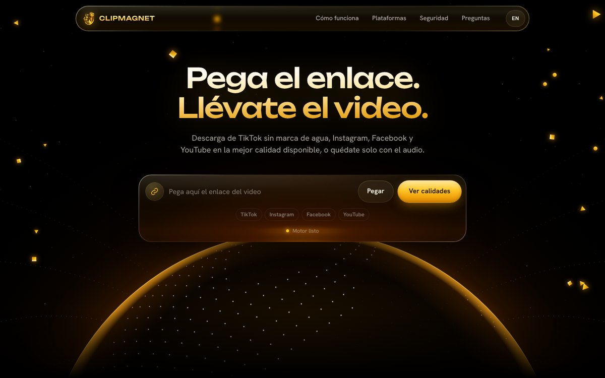
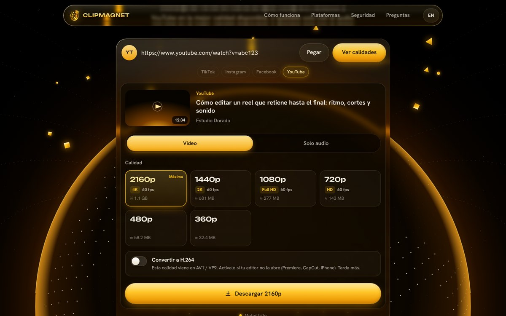

<div align="center">


# CLIPMAGNET

**Pega el enlace. Llévate el video.**

Descarga videos de **TikTok sin marca de agua**, **Instagram**, **Facebook** y **YouTube** en la máxima calidad disponible, o solo el audio en MP3, M4A o WAV.

</div>



---

## Qué hace

| | |
|---|---|
| **Calidad a elegir** | Muestra todas las resoluciones disponibles (de 360p a 8K), con fps y peso aproximado. Por defecto marca la máxima. |
| **TikTok sin marca de agua** | Descarga la versión que TikTok usa para reproducir el video, que no lleva marca. Si una publicación solo existe con marca, avisa. |
| **Solo audio** | MP3 320 kbps, MP3 192 kbps, M4A original (sin recomprimir) o WAV para editar. |
| **Listo para editar** | Todo sale en MP4. Si YouTube entrega VP9/AV1 (habitual en 1440p, 4K y 8K), un interruptor lo convierte a **H.264** para que abra en Premiere, CapCut, Final Cut o iPhone. |
| **Carruseles** | En publicaciones de Instagram con varios videos, eliges cuál descargar. |
| **Seguro** | Solo habla con las 4 plataformas, solo entrega archivos de audio/video verificados con FFprobe y los borra a los 15 minutos. Ver [SECURITY.md](SECURITY.md). |
| **Bilingüe** | Español e inglés (detecta el idioma del navegador). |
| **Diseño** | Cristal líquido dorado con refracción real en Chrome/Edge (desenfoque elegante en Safari y Firefox), responsive y accesible. |



---

## Por qué hay dos partes (y qué va en GitHub)

```
 ┌───────────────────────────┐        ┌────────────────────────────────┐
 │  web/   (la página)        │  ───▶  │  server/   (el motor)           │
 │  HTML + CSS + JS           │  API   │  Python · yt-dlp · FFmpeg       │
 │  Puede vivir en GitHub     │        │  Necesita una computadora o un  │
 │  Pages (gratis)            │        │  servidor que ejecute código    │
 └───────────────────────────┘        └────────────────────────────────┘
```

GitHub guarda el código y puede publicar la página gratis con **GitHub Pages**, pero GitHub Pages solo sirve archivos estáticos: no puede ejecutar el motor que descarga los videos. Por eso tienes tres formas de usar CLIPMAGNET:

1. **En tu computadora** (gratis, lo más fiable, ideal para uso personal).
2. **Todo en un servidor** con Docker: la página y el motor juntos (lo más simple para una web pública).
3. **Página en GitHub Pages + motor en un servidor** (si quieres la URL `tu-usuario.github.io`).

---

## Opción 1 · En tu computadora

Necesitas **Python 3.10 o superior** ([descargar](https://www.python.org/downloads/)). El lanzador instala lo demás (FFmpeg y Deno) y actualiza el motor cada vez que lo abres.

**Mac**
1. Descarga el proyecto (botón verde **Code → Download ZIP**) y descomprímelo.
2. Doble clic en `start-mac.command`. Si macOS lo bloquea: clic derecho → **Abrir**.
   Si no se abre, en Terminal: `bash start-mac.command`
3. Se abre `http://127.0.0.1:8000` en tu navegador. Deja la ventana de Terminal abierta mientras lo uses.

> En Mac se usa [Homebrew](https://brew.sh) para instalar FFmpeg y Deno la primera vez.

**Windows**
1. Descarga y descomprime el proyecto.
2. Doble clic en `start-windows.bat`. La primera vez instala FFmpeg y Deno con `winget` y te pide volver a abrirlo.
3. Se abre `http://127.0.0.1:8000`.

**Linux**
```bash
sudo apt install python3 python3-venv ffmpeg   # y Deno: https://deno.com
bash start-linux.sh
```

En tu computadora el motor solo escucha en `127.0.0.1`: nadie más en tu red puede usarlo.

---

## Opción 2 · Web pública en un servidor (Docker)

```bash
cp .env.example .env          # ajusta límites si quieres
docker compose up -d --build  # abre http://TU-SERVIDOR:8000
```

Funciona en cualquier VPS o en servicios como Render, Railway o Fly.io. Para **Render** ya está incluido `render.yaml`: crea un *Blueprint* apuntando a tu repositorio y listo. Pon un dominio propio y HTTPS delante (Render y Railway lo hacen solos; en un VPS usa Caddy o Cloudflare).

Variables útiles (todas en `.env.example`):

| Variable | Para qué |
|---|---|
| `CM_MAX_HEIGHT` | Resolución máxima (p. ej. `1080` en un plan gratuito, `4320` para 8K). |
| `CM_MAX_DURATION` / `CM_MAX_FILESIZE_MB` | Evitan que alguien descargue películas de 5 horas en tu servidor. |
| `CM_MAX_CONCURRENT` / `CM_RATE_LIMIT` | Descargas simultáneas y peticiones por minuto por persona. |
| `CM_ALLOW_CONVERT` | Activa/desactiva la conversión a H.264 (consume mucha CPU). |
| `CM_TRUST_PROXY_HEADERS` | `true` detrás de Render, Railway o Cloudflare. |
| `CM_PROXY` | Proxy residencial si YouTube bloquea la IP del servidor (ver *Límites*). |

## Opción 3 · Página en GitHub Pages + motor en un servidor

1. Despliega el motor como en la opción 2 y copia su URL (p. ej. `https://clipmagnet-api.onrender.com`).
2. En `web/assets/js/config.js` pon esa URL en `apiBase`.
3. En el servidor define `CM_ALLOWED_ORIGINS=https://TU-USUARIO.github.io`.
4. En GitHub: **Settings → Pages → Source: GitHub Actions**. El flujo `pages.yml` publica la carpeta `web/` cada vez que la cambias.

---

## Subirlo a GitHub

La forma más cómoda sin usar comandos es [GitHub Desktop](https://desktop.github.com/): **File → Add local repository**, elige la carpeta `clipmagnet`, **Publish repository**.

Si prefieres la terminal:
```bash
cd clipmagnet
git init && git add . && git commit -m "CLIPMAGNET"
git branch -M main
git remote add origin https://github.com/TU-USUARIO/clipmagnet.git
git push -u origin main
```

> Si arrastras archivos en la web de GitHub, las carpetas ocultas (`.github`) a veces no se suben. Con GitHub Desktop o `git` no pasa.

Al subirlo se activan solos: pruebas automáticas, auditoría de dependencias, análisis CodeQL y Dependabot (que te propone actualizar yt-dlp cada semana).

---

## Personalizar

- **Textos, enlaces y monetización:** `web/assets/js/config.js` (es el único archivo que necesitas tocar).
- **Colores:** variables al inicio de `web/assets/css/clipmagnet.css` (`--gold`, `--ember`, `--ink`…).
- **Textos de la interfaz en español e inglés:** `web/assets/js/i18n.js`.
- **Ver el diseño sin motor:** pon `demo: true` en `config.js` y añade `<script src="assets/js/demo.js"></script>` antes de `app.js` en `index.html`.

Ideas para ganar dinero con la herramienta: [MONETIZACION.md](MONETIZACION.md).

---

## Límites conocidos (y cómo vivir con ellos)

- **YouTube en servidores:** YouTube suele frenar las IP de centros de datos con el mensaje *"Sign in to confirm you're not a bot"*. En tu computadora casi nunca pasa. En un servidor público, las opciones son: un proxy residencial (`CM_PROXY`), o cookies de una cuenta **secundaria** (`CM_COOKIES_FILE`, con riesgo de que esa cuenta sea bloqueada).
- **Instagram** a veces pide iniciar sesión cuando recibe muchas peticiones desde la misma IP.
- **Contenido privado, con restricción de edad o en vivo** no se descarga: CLIPMAGNET solo ve lo que vería un visitante sin sesión.
- **Las plataformas cambian a menudo.** Si algo deja de funcionar, casi siempre se arregla actualizando yt-dlp: el lanzador lo hace solo al abrirse; en Docker, reconstruye la imagen (`docker compose up -d --build`).

---

## Estructura

```
clipmagnet/
├── web/                     Página (estática, lista para GitHub Pages)
│   ├── index.html
│   └── assets/  css · js · fonts · img
├── server/                  Motor (FastAPI + yt-dlp + FFmpeg)
│   ├── app/  main.py · downloader.py · security.py · config.py
│   └── tests/
├── start-mac.command        Lanzadores para uso local
├── start-windows.bat
├── start-linux.sh
├── Dockerfile · docker-compose.yml · render.yaml · .env.example
├── .github/                 Pruebas, CodeQL, GitHub Pages, Dependabot
├── SECURITY.md · MONETIZACION.md · LICENSE
```

**Desarrollo**
```bash
cd server
python -m venv .venv && source .venv/bin/activate
pip install -r requirements-dev.txt
python -m pytest -q                         # 39 pruebas
python -m uvicorn app.main:app --reload     # http://127.0.0.1:8000
```

---

## Aviso legal

CLIPMAGNET es una herramienta independiente, sin relación con TikTok, Instagram, Facebook ni YouTube. Está pensada para descargar **contenido propio, con licencia o con permiso de su autor**. Los términos de servicio de estas plataformas restringen la descarga de contenido de terceros, y los derechos de cada video siguen siendo de quien lo creó. Si publicas una versión pública, añade una página de términos y un correo de contacto para solicitudes de retiro.

## Licencia y créditos

Código bajo licencia [MIT](LICENSE). Usa [yt-dlp](https://github.com/yt-dlp/yt-dlp) (Unlicense), [FFmpeg](https://ffmpeg.org) (LGPL/GPL), [FastAPI](https://fastapi.tiangolo.com) (MIT) y las tipografías Unbounded y Hanken Grotesk ([SIL OFL 1.1](web/assets/fonts/)).
